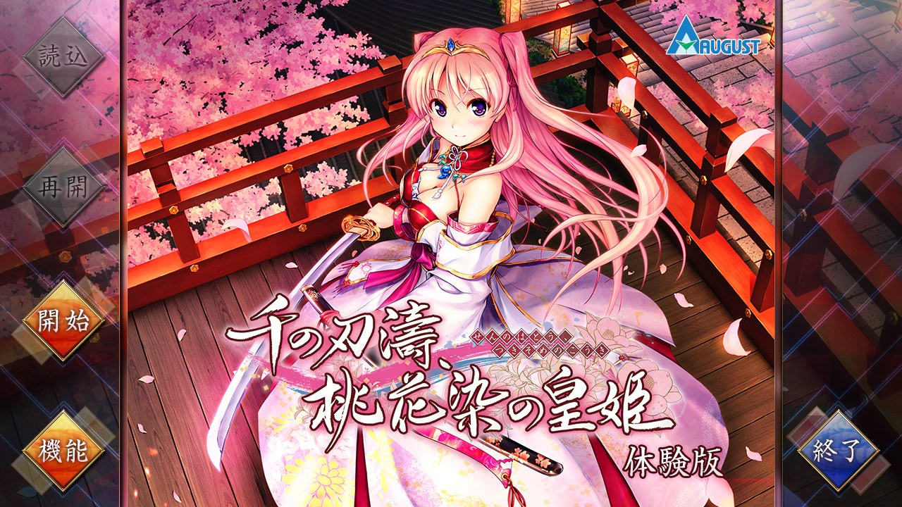
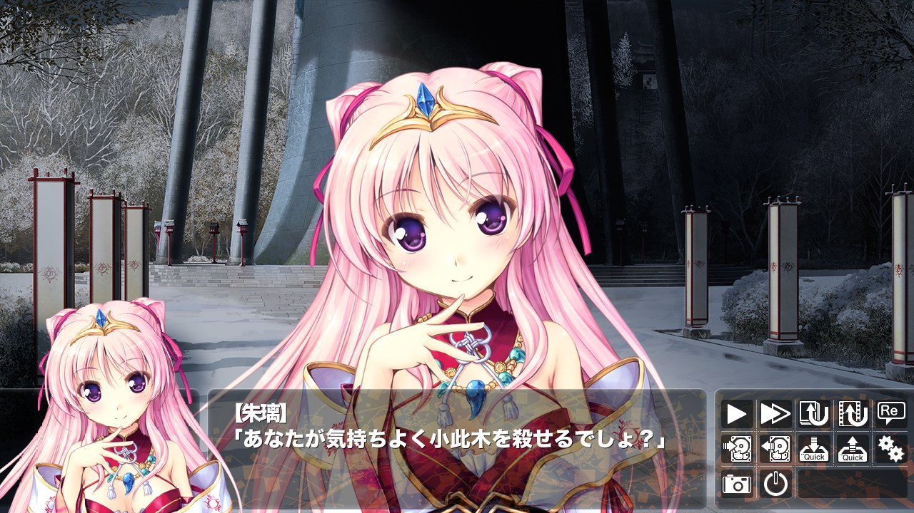
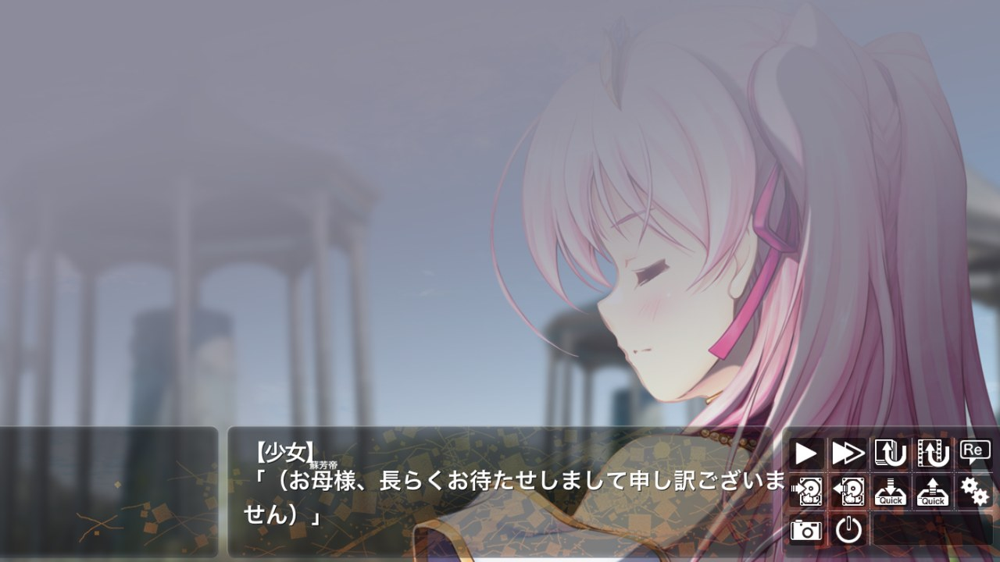

# ethornell-rs

`ethornell-rs` is a reimplementation of the Ethornell / BURIKO General Interpreter (a.k.a. "BGI") visual novel engine.

<table>
  <tr>
    <td width="50%" align="center">
      <br>
      <b>Desktop</b><br>
      <sub>千の刃濤、桃花染の皇姫 体験版 (BGI 1.622), title screen.</sub>
    </td>
    <td width="50%" align="center">
      <br>
      <b>Desktop</b><br>
      <sub>Character sprites, face window and message window.</sub>
    </td>
  </tr>
  <tr>
    <td width="50%" align="center">
      <br>
      <b>Web</b><br>
      <sub>The same game in Chrome (WebAssembly, WebGL2).</sub>
    </td>
    <td width="50%"></td>
  </tr>
</table>

The runtime detects the native game identifier from the comparison in
`system.arc:ipl._bp`. If detection is unavailable, the identifier falls back to
`Tayutama2TV`. For example:

```sh
cargo run -p ethornell-cli -- run --game /path/to/game
```

`--game` locates the resource archives, loose files, and user data.

Without arguments (a double-click), `ethornell` asks for the game folder;
`ethornell /path/to/sun_flower` plays it directly.

Builds for Windows (x86_64), Linux (x86_64 and AArch64), FreeBSD (x86_64),
macOS (a universal `Ethornell.app`), Android (APK), iOS (unsigned IPA), the
web (a static page), Nintendo Switch (NRO) and PS Vita (VPK) are published on
[GitHub Releases](https://github.com/xmoezzz/ethornell-rs/releases).
The `pre-release` entry follows `main`; `v*` tags publish versioned releases.
See [`platform/`](platform/README.md) for building and using each platform,
including the Android and iOS apps and the console ports.

The window uses the game's icon from `icon.png`, an `.ico` file, or the icon
resources embedded in its Windows executable, in that order.

For a GBK Chinese translation, also set `ETHORNELL_TEXT_ENCODING=gbk`.
The default is Shift-JIS (`cp932`). It does not change the encoding of resource names or BP system strings.


## Claims
<p align="center">
  
</p>

This project belongs to `CrySirror` [project](https://github.com/xmoezzz/CrySirror), which is a unified engine backend for visual novels and 3D games. 

1. Bug fixes and improvements for the original Ethornell / BURIKO General Interpreter (a.k.a. "BGI") engine is acceptable in this repository. 

2. If you want to support a new platform (e.g. game console), please create an issue or pull request in the `CrySirror` repository instead of this one. 
